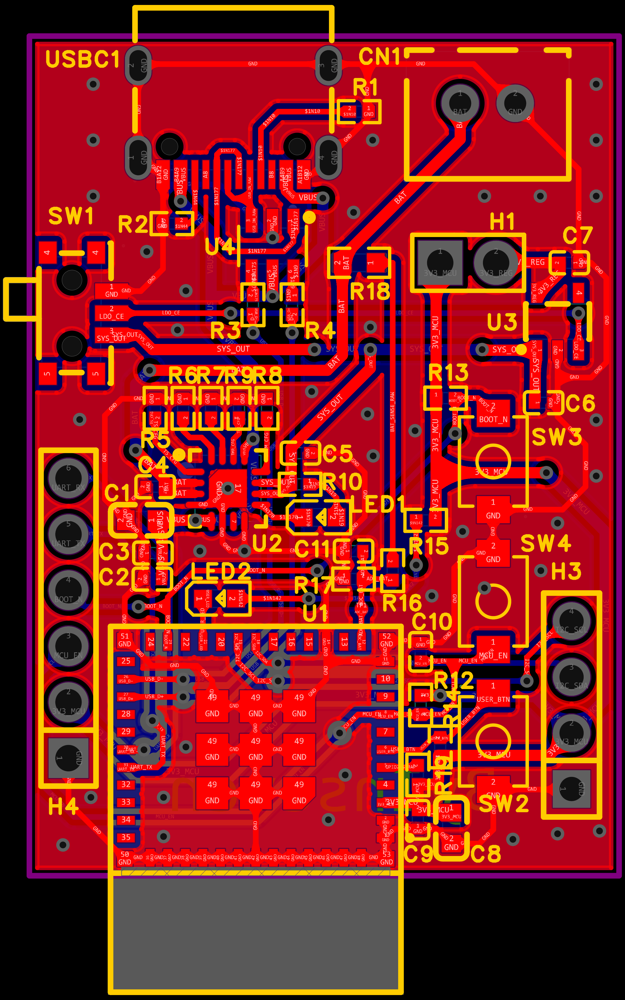

# ESP32-C3 PC Prototype

自制 ESP32-C3 板与 PC 通信的分阶段原型：从 USB 串口与板级自检，到 ESP-NOW 无线接收器，再到电池与低功耗实验。

作者：Jiang Peichen / Inseven。

固件使用 ESP-IDF 原生 C 工程，提供单板自检、无线设备端和 USB 接收端三种构建角色。PC 目前通过串口终端交互；独立桌面 GUI、USB HID 和低功耗验收仍未完成。



## 当前状态

| 内容 | 证据与限制 |
| --- | --- |
| USB 枚举、内置 USB-JTAG、烧录、串口日志、RESET | 原开发记录记载通过；本次整理未重新烧录 |
| 单板心跳、按键、LED 命令、电池 ADC | 已实现；本次构建通过，板上验收范围见验证记录 |
| ESP-NOW 配对、ADC/LED/INFO 命令 | 留存 2026-07-31 双板终端日志；不是整理后版本的重新验收 |
| 无线按键事件、重试、NVS 保存配对 | 已实现，留存日志不足以证明全部边界行为 |
| I2C、UART 外设测试、BLE、睡眠与实际功耗 | 未完成 |
| 电池充电安全、温升、无线距离、长期稳定性 | 未完成系统验收 |

证据来源与本次结果见 [验证记录](docs/validation.md)。本仓库定位为开发原型。

## 快速开始

- 主控：ESP32-C3-MINI-1-H4X，自制板。
- 已使用工具链：Windows、PowerShell 7、ESP-IDF v6.0.2、乐鑫 VS Code 扩展。
- 从 ESP-IDF 已激活的 PowerShell 进入仓库根目录，执行：

```powershell
./scripts/build.ps1 -Role standalone
./scripts/build.ps1 -Role device
./scripts/build.ps1 -Role receiver
```

每种角色使用独立构建目录和生成配置。首次完整构建会生成 ESP-IDF 的标准输出文件，不需要额外第三方组件。

本版 PCB 的 GPIO8 没有外部上拉，**默认通过内置 USB-JTAG、1000 kHz 烧录**。不要默认使用串口 `flash` 或要求按住 BOOT。完整步骤见 [构建与烧录](docs/getting-started.md)。

ESP-NOW 需要两块板。公开版本使用演示密钥，不能与原测试固件直接混用；两端必须使用相同配置。操作见 [无线通信](docs/wireless.md)。

## 仓库内容

```text
hello_world/           ESP-IDF 固件，保留原工程名称
  main/                三种角色及共享无线协议
  openocd/             内置 USB-JTAG 1 MHz 配置
hardware/source/       嘉立创 EDA 专业版便携工程快照
hardware/images/       原理图和 PCB 布局截图
hardware/manufacturing/ 历史 Gerber、BOM 与坐标文件
docs/                  烧录、引脚、无线、验证与后续计划
scripts/build.ps1      三角色构建入口
LICENSES/              许可证文本
```

硬件源为 2026-07-18 22:02 的便携备份，尚未证明与最后更新的本地原生数据库及实物完全一致。制造文件也属于历史快照，重新生产前应在 EDA 中核对源工程、网表、DRC 和 BOM；具体版本见 [硬件说明](hardware/README.md)。

## 文档

- [构建、JTAG 烧录和串口监视](docs/getting-started.md)
- [引脚与硬件限制](docs/hardware.md)
- [配对、终端命令和无线限制](docs/wireless.md)
- [验证记录与历史日志](docs/validation.md)
- [后续计划](docs/roadmap.md)
- [文件来源与公开范围](docs/publication.md)

## 许可证

原创固件与构建脚本采用 [MIT](LICENSE)，原创硬件设计、图片与文档采用 [CC BY 4.0](LICENSES/CC-BY-4.0.txt)。已有 SPDX 标记的文件、供应商符号/封装及第三方资源保留各自权利与许可，详见 [第三方说明](THIRD_PARTY_NOTICES.md)。
