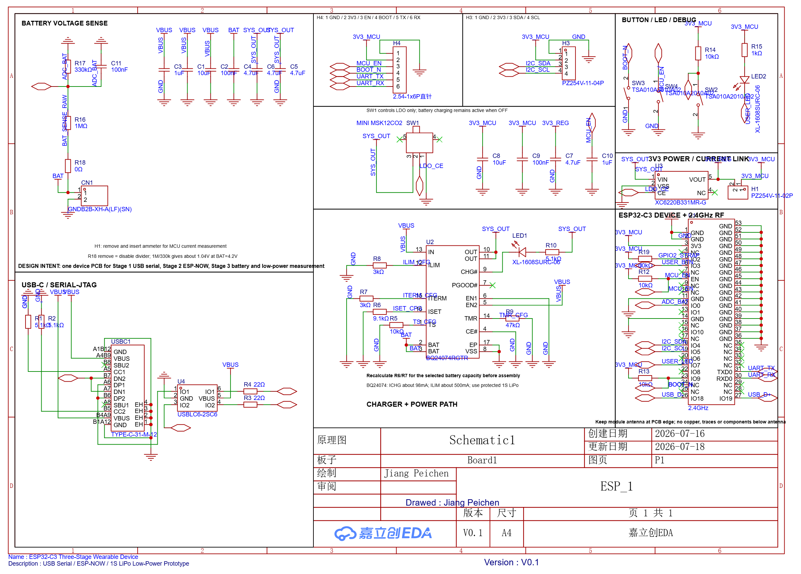

# 引脚与硬件限制

以下映射依据 2026-07-18 原理图截图核对，与现有固件一致。旧网表中的连接器位号是 J3/J4，后续原理图显示 H3/H4；不要混用不同快照。

| 功能 | GPIO / 引脚 | 有效电平 / 说明 |
| --- | --- | --- |
| 用户按键 SW2 | GPIO3 | 按下接地，低有效；原理图有 10 kΩ 上拉 |
| 用户 LED | GPIO7 | 灌电流，低有效；本版 LED 有已知硬件问题 |
| 电池 ADC | GPIO0 / ADC1_CH0 | R16=1 MΩ、R17=330 kΩ，R18=0 Ω；换算倍率约 4.03 |
| I2C SDA / SCL | GPIO4 / GPIO5 | H3: 1 GND、2 3V3、3 SDA、4 SCL；固件尚未测试 |
| UART TX / RX | GPIO21 / GPIO20 | H4: 1 GND、2 3V3、3 EN、4 BOOT、5 TX、6 RX；尚未测试 |
| USB D- / D+ | GPIO18 / GPIO19 | 内置 USB Serial/JTAG |
| BOOT | GPIO9 | 按键接地，原理图有 10 kΩ 上拉 |
| GPIO8 | 未接外部上拉 | 本版 ROM USB/UART 下载限制 |

ADC 日志表示采样值与按电阻比例换算的电压，不等同于电池百分比。未接电池、分压未连接或高阻输入稳定时间不足时，输出不能代表真实电池状态。应与万用表比较后再评价误差。

原理图含 BQ24074 充电/电源路径、XC6220 稳压与 H1 电流测量链接。原设计要求按所选电池核对充电参数；本次没有进行充电、保护或温升验收。SW1 作用于 LDO，使其关闭不等于切断充电路径。

下一版计划补 GPIO8 外部上拉与必要测试点。本次开源整理未修改原理图、PCB、LED 电路或现有本地开发配置。
